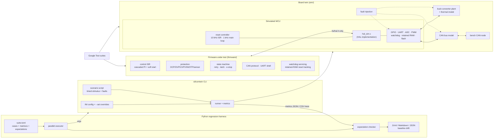

# SiliconTwin

**Firmware simulator and hardware-in-the-loop test framework**

SiliconTwin runs real power-electronics control firmware on a simulated microcontroller, so you
can check it without a board, a power supply, or a CAN analyser. The firmware under test is a
digitally controlled 48 V to 12 V synchronous buck converter controller written in C. It
reaches hardware only through a small HAL (`firmware/include/fw/hal.h`). The simulator
implements that HAL with emulated peripherals and an analog plant model:

- **UART**: byte timing derived from the baud rate, 32-byte hardware FIFOs, overrun and framing errors, and line-noise injection.
- **GPIO**: direction and pull resistors, an external bench driver, stuck-at faults, and edge interrupts dispatched into firmware ISRs.
- **CAN 2.0A**: ID arbitration, frame timing with bit stuffing, acceptance filters, and an RX FIFO. It also models TEC/REC fault confinement (error-active, error-passive and bus-off), automatic retransmission, and the 128x11-bit bus-off recovery.
- **ADC and PWM**: 12-bit quantisation with seeded Gaussian noise, plus stuck and offset faults. The PWM has duty clamping and a hardware break input wired to the e-stop.
- **Independent watchdog**: the timeout can be written only once. When it expires the MCU resets and records the reset cause. Retained (no-init) RAM survives warm resets.
- **Plant**: an averaged buck converter model (L, C, DCR, load). When switching stops, the inductor freewheels through the diodes. A first-order thermal model covers the switch stage.
- **Fault injection**: output short, ADC stuck or offset, CAN error rate and forced bus-off, UART noise, firmware hang, GPIO stuck, brown-out, and over-temperature.

The firmware covers several functions:

- **Control loops**: a cascaded voltage/current loop runs in a 10 kHz ISR. It has anti-windup, an inherent current limit, and a pre-bias-safe soft start.
- **Protection**:
  - Fast checks: OCP and OVP.
  - Debounced checks: UVP, the VIN window, OTP, and a model-based plausibility check on the vout sensor.
  - Retry and latch-off policy.
- **Watchdog recovery**: the firmware services the watchdog only while the control ISR is alive. If watchdog resets keep happening, it detects the reset loop and latches off. A latch persists across watchdog resets.
- **Parameter storage**: the parameter flash block is CRC-protected. If the block is invalid, the firmware falls back to built-in defaults.
- **Communication**: a CAN telemetry/command protocol and a non-blocking UART shell.

On top of this sit two test layers:

- **Google Test suites** cover every peripheral model, the firmware modules, and firmware-in-the-loop behaviour.
- **A Python harness** (`silicontwin-regress`) runs the simulator across configuration matrices and fault scenarios. It checks declarative expectations and writes JUnit, Markdown and JSON reports. It can also gate on metric drift against a baseline.

## Architecture



Each simulation step (10 µs) does four things in order:

1. It integrates the plant, using 1 µs Euler sub-steps at the PWM duty currently applied.
2. It advances the clock and samples the analog values into the ADC inputs.
3. It clocks the UART and CAN.
4. It runs any MCU interrupts that are due, plus the 1 kHz super-loop tick.

All randomness comes from one seeded xorshift PRNG, so the same seed reproduces a run bit for bit.

The firmware is compiled as a CMake `OBJECT` library that can only see `firmware/include`. A
port to real silicon would replace `sim/src/hal_sim.c` and leave the firmware unchanged.

## Repository layout

```
firmware/          production firmware (C11): params, retained, control, protection,
                   can_proto, shell, firmware (state machine) + fw/hal.h
sim/               simulator (C11): clock, rng, gpio, uart, can, adc, pwm, watchdog,
                   plant, mcu, hal_sim, faults, board, config, scenario, runner
app/main.c         silicontwin CLI
tests/             Google Test suites (C++17)
configs/           board/firmware configurations (INI)
scenarios/         stimulus and fault-injection scripts
regression/        regression suite definition (TOML)
harness/           Python harness package + pytest tests
```

## Requirements

- CMake 3.16 or newer, and a C11/C++17 compiler (GCC, Clang or MSVC).
- Python 3.9 or newer for the harness. On Python 3.9 and 3.10 it also needs `tomli`; 3.11 and later use the built-in `tomllib`.
- Google Test. CMake uses an installed copy if it finds one, and otherwise downloads v1.14.0 with `FetchContent`, which needs network access on the first configure.

You don't need any hardware, credentials or environment secrets.

## How to run

Build:

```bash
cmake -S . -B build -DCMAKE_BUILD_TYPE=Release
cmake --build build -j
```

Run a single simulation. Metrics go to stdout as JSON and a one-line summary goes to stderr:

```bash
./build/silicontwin --config configs/nominal_12v.ini --scenario scenarios/load_step.scn
./build/silicontwin --config configs/nominal_12v.ini --scenario scenarios/short_circuit.scn \
    --json out/short.json --trace out/short.csv
./build/silicontwin --config configs/nominal_12v.ini --set firmware.kp_v=2.0 \
    --set plant.r_load=1.6 --seed 7
```

Run the regression suite through the harness:

```bash
pip install -e harness            # or: export PYTHONPATH=harness
silicontwin-regress list regression/suite.toml
silicontwin-regress run regression/suite.toml -j 8 \
    --junit out/junit.xml --report out/summary.md --json out/results.json
silicontwin-regress run regression/suite.toml --tags smoke
silicontwin-regress run regression/suite.toml --baseline regression/baseline.json --update-baseline
silicontwin-regress run regression/suite.toml --baseline regression/baseline.json   # gate on drift
```

The harness looks for the simulator in this order: `--binary`, then `$SILICONTWIN_BIN`, then
`build/silicontwin`, then `PATH`.

### Configuration

The INI sections are `[sim]`, `[plant]`, `[bench]` and `[firmware]`. `sim/include/sim/config.h`
lists every key. You can override any key from the command line with `--set section.key=value`.
`[firmware]` values are sealed with a CRC and programmed into the simulated parameter flash. Set
`corrupt_flash = true` to check the firmware's fallback to its defaults.

### Scenario scripts

Each line is `<time_ms> <command> [args]`. The commands are:

- `enable 0|1`
- `estop 0|1`
- `load <ohm>`
- `vin <V>`
- `uart "<text>"`
- `can <id> <hex bytes...>`
- `can_cmd vref|ilim|clear|reset|hang [value]`
- `fault <name> [a] [b]` and `clear <name> [a] [b]`
- `mark <label>`, which opens a measurement window and reports min/max and settling time
- `end`

The fault names are `output_short`, `adc_stuck`, `adc_offset`, `can_errors`, `can_bus_off`,
`uart_noise`, `fw_hang`, `gpio_stuck`, `brownout` and `overtemp`.

### Expectations

Suite cases assert on dotted paths into the metrics JSON. Here is an example:

```toml
[case.expect]
"firmware.final_state" = "REGULATING"
"regulation.vout_final" = { approx = "$regulation.vref_final", rel = 0.01 }
"regulation.startup_ms" = { min = 15, max = 45 }
"faults[0].fault" = "OCP"
"transitions[*].to" = { contains = "LATCHED" }
"uart.output" = { contains = "OK vref=9.500" }
```

The available operators are `eq`, `ne`, `min`, `max`, `approx` (with `tol`/`rel`), `contains`,
`not_contains`, `in`, `len`, `len_min`, `len_max` and `regex`. A `matrix` table expands one case
into the cartesian product of configs, scenarios, seeds and parameter overrides.

## How to test

C and C++ unit and firmware-in-the-loop tests (Google Test, via CTest):

```bash
cmake -S . -B build && cmake --build build -j
ctest --test-dir build --output-on-failure
# or run the binary directly, e.g. only the HIL tests:
./build/tests/silicontwin_tests --gtest_filter='Hil.*'
```

Harness tests (pytest). These use a fake simulator, so they don't need a build:

```bash
pip install -e 'harness[test]'
cd harness && pytest -q
```

End-to-end regression (needs the build):

```bash
silicontwin-regress run regression/suite.toml
```

## Firmware behaviour

| Condition | Detection | Response |
|---|---|---|
| Over-current, over-voltage | single sample in the 10 kHz ISR | switch off, retry after `retry_delay_ms`, latch after `max_retries` |
| Output under-voltage (e.g. short at current limit) | 20 ms debounce while regulating | retry / latch |
| Input outside `[vin_min, vin_max]` | 5 ms debounce | off; auto-restart with 1 V hysteresis, no retry consumed |
| Over-temperature | 10 ms debounce | off; restart below `otp_clear` |
| Vout sensor stuck / implausible | rail check + d·Vin model mismatch, 3 ms | latch-off (never auto-restart) |
| Main loop hung | watchdog (`wdt_timeout_ms`) | MCU reset; 3 consecutive resets without 1 s of healthy regulation latch off |
| Control ISR dead | watchdog not serviced | MCU reset |
| E-stop asserted | hardware PWM break + GPIO ISR | immediate shutdown; enable must cycle before restart |
| CAN bus-off | controller state | request recovery, telemetry resumes |
| Corrupted UART input | overrun/framing/non-printable | line discarded, never executed |
